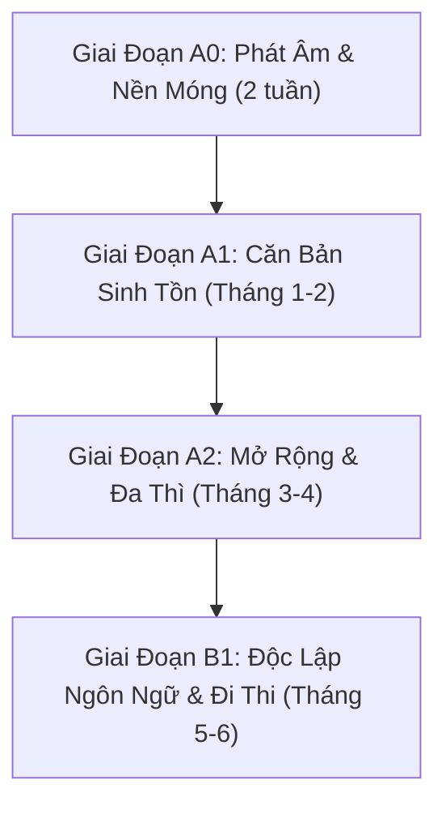

# 🇩🇪 German Tutor Skill (Gia Sư Tiếng Đức AI 1-1: A0 ➔ B1 Cứng)

[](https://opensource.org/licenses/MIT)
[](#)
[](#)

Gia sư AI 1-1 dạy kèm tiếng Đức bài bản cho người Việt **bắt đầu hoàn toàn từ con số 0 (A0)** lên trình độ **B1 Cứng** theo chuẩn khung tham chiếu Châu Âu (CEFR / Goethe-Zertifikat / telc).

---

## ✨ 4 Cải Tiến Đột Phá Cho Người Mới Bắt Đầu

1. 🇻🇳 **Phiên âm bồi thuần Việt `[...]` nguyên cả câu**:
   - Thay vì dùng ký hiệu ngữ âm quốc tế (IPA) khó đọc, toàn bộ từ và câu giao tiếp đều có phiên âm bồi thuần Việt đặt trong ngoặc vuông liền mạch theo nhịp nói:
     $$\text{Ich heiße Nam} \longrightarrow \mathbf{[\text{Ích - hai - sơ - Nam}]}$$
2. ⚡ **Phản xạ với câu lệnh tự nhiên: "Học tiếp"**:
   - Không cần nhớ mã bài hay gõ lệnh `/tutor` phức tạp. Chỉ cần gõ: **"học tiếp"**, **"tiếp tục"** hoặc **"dạy bài mới"**, AI sẽ tự động đọc `progress.json` và dạy tiếp ngay mẩu kiến thức tiếp theo.
3. 📁 **Ghim cố định Thư mục Sổ tay Học tập**:
   - Toàn bộ từ vựng, lỗi sai và tiến độ được tự động lưu trữ tại:
     📂 `C:\Users\anh58\Hoc_Tieng_Duc\so_tay_tieng_duc.md`
     📂 `C:\Users\anh58\Hoc_Tieng_Duc\progress.json`
4. 🎧 **Tích hợp sẵn Tài nguyên vàng**:
   - Nhúng liên kết trực tiếp tới các công cụ nghe và học miễn phí tốt nhất nước Đức: DW Nicos Weg, Forvo, Easy German và Đề thi mẫu B1 Goethe.

---

## 🎧 Kho Tài Nguyên Vàng Nhúng Kèm

* **Từ điển phát âm người bản xứ Forvo**: [https://forvo.com/languages/de/](https://forvo.com/languages/de/) *(Tra từ để nghe người Đức thật đọc)*
* **Khóa phim tương tác DW Nicos Weg (Miễn phí 100%)**: [https://learngerman.dw.com/de/nicos-weg/c-36519687](https://learngerman.dw.com/de/nicos-weg/c-36519687)
* **Kênh YouTube đường phố Easy German**: [https://www.youtube.com/@EasyGerman](https://www.youtube.com/@EasyGerman)
* **Bộ đề thi mẫu Goethe-Zertifikat B1**: [https://www.goethe.de/de/spr/kup/prf/prf/gb1/ueb.html](https://www.goethe.de/de/spr/kup/prf/prf/gb1/ueb.html)

---

## 🗺️ Lộ Trình Đào Tạo Chuẩn CEFR (A0 ➔ B1 Cứng)



| Cấp độ | Giáo trình chi tiết | Trọng tâm kiến thức |
| :---: | :--- | :--- |
| **A0** | [curriculum/A0_Phat_Am_Nen_Tang.md](curriculum/A0_Phat_Am_Nen_Tang.md) | Bảng chữ cái, Umlaute (ä, ö, ü, ß), quy tắc ghép âm bồi thuần Việt, số đếm đảo ngược, chào hỏi và tự giới thiệu. |
| **A1** | [curriculum/A1_Can_Ban_Sinh_Ton.md](curriculum/A1_Can_Ban_Sinh_Ton.md) | Chia động từ hiện tại, trợ động từ *sein/haben*, quy tắc động từ vị trí số 2 (V2), mạo từ der/die/das, cách 1 & cách 4 (Akkusativ), Modalverben, động từ tách, thì quá khứ giao tiếp (Perfekt). |
| **A2** | [curriculum/A2_Mo_Rong_Giao_Tiep.md](curriculum/A2_Mo_Rong_Giao_Tiep.md) | Cách 3 (Dativ), giới từ Akkusativ/Dativ, giới từ 2 cách (Wechselpräpositionen: Wohin vs Wo), liên từ đẳng lập ADUSO vs liên từ phụ thuộc đá động từ (weil/dass/wenn/ob), quá khứ đơn Präteritum, so sánh hơn/nhất, viết email đời sống. |
| **B1 Cứng** | [curriculum/B1_Doc_Lap_Chuan_Goethe.md](curriculum/B1_Doc_Lap_Chuan_Goethe.md) | Làm chủ hoàn toàn Đuôi tính từ (Adjektivdeklination), mệnh đề quan hệ (Relativsätze), thể bị động (Passiv), thể giả định 2 (Konjunktiv II), động từ kèm giới từ cố định, liên từ kép, mục đích *um...zu/damit*, sở hữu cách (Genitiv), cẩm nang đỗ 4 kỹ năng Goethe B1. |

---

## 🚀 Cách Bắt Đầu Học Ngay

Trong cửa sổ trò chuyện với AI, bạn chỉ cần gõ:
```text
học tiếp
```
hoặc:
```text
/tutor lesson A0.1
```
Gia sư AI sẽ tự động đọc sổ tay học tập tại `C:\Users\anh58\Hoc_Tieng_Duc\progress.json` và giảng bài tiếp theo cho bạn ngay lập tức!

---

## ⌨️ Bảng Lệnh Điều Khiển

| Lời thoại / Câu lệnh | Mô tả hành vi |
| :--- | :--- |
| **"học tiếp" / "tiếp tục"** | Tự động học bài kế tiếp theo tiến độ trong `progress.json`. |
| `/tutor status` hoặc **"xem tiến độ"** | Mở sổ tay, báo cáo bài đã học, từ vựng và lỗi sai. |
| `/tutor practice` hoặc **"cho bài tập"** | Tạo bài tập phản xạ (điền từ, dịch câu, trắc nghiệm). |
| `/tutor roleplay [chủ đề]` | Đóng vai hội thoại đời sống tại Đức theo trình độ hiện tại. |
| `/tutor review` hoặc **"ôn từ vựng"** | Ôn tập ngắt quãng từ vựng và các lỗi sai cũ. |
| `/tutor exam` | Luyện giải đề thi viết và thuyết trình nói chuẩn format B1. |

---

## 📂 Cấu Trúc Thư Mục

```text
german-tutor/
├── SKILL.md                          # Trí tuệ gia sư AI (Luật sửa lỗi 3 bước, phản xạ 'học tiếp')
├── README.md                         # Tài liệu hướng dẫn sử dụng & tài nguyên vàng
├── curriculum/                       # Toàn bộ giáo trình A0 -> B1
│   ├── A0_Phat_Am_Nen_Tang.md        # A0: Phát âm bồi thuần Việt, Umlaute, số đếm, chào hỏi
│   ├── A1_Can_Ban_Sinh_Ton.md        # A1: Động từ sein/haben, V2, der/die/das, Akkusativ, Perfekt
│   ├── A2_Mo_Rong_Giao_Tiep.md       # A2: Dativ, Wechselpräpositionen, câu phụ weil/dass
│   └── B1_Doc_Lap_Chuan_Goethe.md    # B1 Cứng: Đuôi tính từ, Relativsatz, Passiv, Konjunktiv II, 4 kỹ năng
└── templates/                        # Mẫu sổ tay học tập
    ├── so_tay_tieng_duc.md           # Mẫu sổ tay từ vựng & lỗi sai
    └── progress.json                 # Mẫu file theo dõi tiến độ
```

---

## 👤 Tác Giả & Bản Quyền

- Tác giả: [@huuanh20](https://github.com/huuanh20)
- Giấy phép: MIT License
