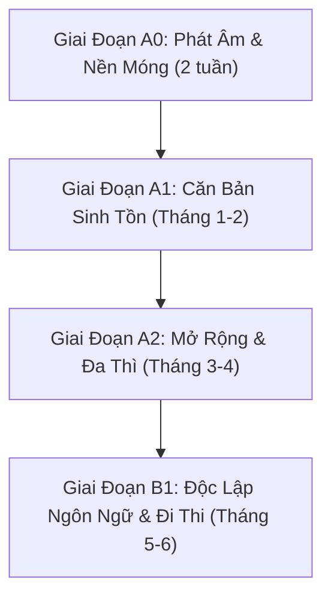

# 🇩🇪 German Tutor Skill (Gia Sư Tiếng Đức AI 1-1: A0 ➔ B1 Cứng)

[](https://opensource.org/licenses/MIT)
[](#)
[](#)

Skill gia sư tiếng Đức 1-1 chuyên sâu dành cho người Việt Nam **bắt đầu hoàn toàn từ con số 0 (A0)** muốn đạt trình độ **B1 Cứng** theo chuẩn khung tham chiếu Châu Âu (CEFR / Goethe-Zertifikat / telc).

---

## ✨ Điểm Khác Biệt & Triết Lý Sư Phạm

* 🇻🇳 **100% Giải thích bằng Tiếng Việt**: So sánh trực quan ngữ pháp tiếng Đức với tiếng Việt và tiếng Anh, giúp người học dễ hiểu bản chất thay vì học vẹt.
* 👶 **Không đốt cháy giai đoạn**: Bắt đầu tỉ mỉ từ Bảng chữ cái, Umlaute (*ä, ö, ü*), chữ cái đặc thù *ß*, các cụm âm ghép (*ch, sch, sp, st, ei, ie*), và cách đọc số đảo ngược.
* 🧩 **Micro-learning (Viên nhỏ kiến thức)**: Mỗi bài học chỉ gồm:
  $$\text{1 Mẩu ngữ pháp} + \text{2-4 Ví dụ đối chiếu} + \text{1 Bài tập tương tác ngay tại chỗ}$$
* 🔍 **Quy trình Sửa bài 3 bước (Correction Loop)**:
  1. *Khen ngợi nỗ lực & ghi nhận ý muốn diễn đạt*.
  2. *Mổ xẻ lỗi sai*: Giống từ (*der/die/das*), cách biến đổi (*Nom/Akk/Dat/Gen*), chia đuôi động từ, trật tự từ vị trí số 2 hoặc cuối câu.
  3. *Bản chuẩn người bản xứ* + giải thích tại sao.
* 📓 **Tự động lưu Sổ tay cá nhân**: Ghi chép từ vựng mới và các điểm hay quên vào file `so_tay_tieng_duc.md` trên máy của bạn để ôn tập ngắt quãng (Spaced Repetition).

---

## 🗺️ Lộ Trình Đào Tạo Chuẩn CEFR (A0 ➔ B1 Cứng)



| Cấp độ | Giáo trình chi tiết | Trọng tâm kiến thức |
| :---: | :--- | :--- |
| **A0** | [curriculum/A0_Phat_Am_Nen_Tang.md](curriculum/A0_Phat_Am_Nen_Tang.md) | Bảng chữ cái, Umlaute (ä, ö, ü, ß), quy tắc phát âm ch/sch/sp/st/ei/ie, số đếm đảo ngược, chào hỏi và tự giới thiệu. |
| **A1** | [curriculum/A1_Can_Ban_Sinh_Ton.md](curriculum/A1_Can_Ban_Sinh_Ton.md) | Chia động từ hiện tại, trợ động từ *sein/haben*, quy tắc động từ vị trí số 2 (V2), mạo từ der/die/das, cách 1 & cách 4 (Akkusativ), Modalverben, động từ tách, thì quá khứ giao tiếp (Perfekt). |
| **A2** | [curriculum/A2_Mo_Rong_Giao_Tiep.md](curriculum/A2_Mo_Rong_Giao_Tiep.md) | Cách 3 (Dativ), giới từ Akkusativ/Dativ, giới từ 2 cách (Wechselpräpositionen: Wohin vs Wo), liên từ đẳng lập ADUSO vs liên từ phụ thuộc đá động từ (weil/dass/wenn/ob), quá khứ đơn Präteritum, so sánh hơn/nhất, viết email đời sống. |
| **B1 Cứng** | [curriculum/B1_Doc_Lap_Chuan_Goethe.md](curriculum/B1_Doc_Lap_Chuan_Goethe.md) | Làm chủ hoàn toàn Đuôi tính từ (Adjektivdeklination), mệnh đề quan hệ (Relativsätze), thể bị động (Passiv), thể giả định 2 (Konjunktiv II), động từ kèm giới từ cố định, liên từ kép, mục đích *um...zu/damit*, sở hữu cách (Genitiv), cẩm nang đỗ 4 kỹ năng Goethe B1. |

---

## 🚀 Hướng Dẫn Cài Đặt & Sử Dụng

### Cách 1: Dùng trực tiếp với Antigravity (Khuyên dùng)
Skill đã được định dạng chuẩn `SKILL.md` để Antigravity nhận diện tự động.

Chỉ cần sao chép thư mục vào thư mục skill của bạn:
```bash
# Windows
mkdir "%USERPROFILE%\.gemini\config\skills\german-tutor"
copy "SKILL.md" "%USERPROFILE%\.gemini\config\skills\german-tutor\SKILL.md"
```

Sau đó trong cửa sổ chat với AI, bạn chỉ cần gõ:
```text
/tutor lesson A0.1
```
hoặc trò chuyện: *"Hôm nay dạy tôi bài đầu tiên tiếng Đức nhé!"*

---

### Cách 2: Dùng với Claude Code / Cursor / Roo Code / Cline
Clone repo này vào thư mục dự án hoặc thư mục config của công cụ:
```bash
git clone https://github.com/huuanh20/german-tutor.git
```
Tham chiếu file `SKILL.md` làm System Prompt hoặc Context Instruction.

---

## ⌨️ Bảng Lệnh Điều Khiển (Slash Commands)

| Lệnh | Mô tả |
| :--- | :--- |
| `/tutor status` | Báo cáo tiến độ học hiện tại, bài đã học và bài tiếp theo. |
| `/tutor lesson [chủ đề/bài]` | Học một bài học mới (ví dụ: `/tutor lesson A0.1`, `/tutor lesson Akkusativ`). |
| `/tutor practice` | Tạo các bài tập tương tác (điền từ, dịch câu, chọn đáp án đúng). |
| `/tutor roleplay [tình huống]` | Đóng vai hội thoại đời sống (đi chợ, gọi món tại nhà hàng, gặp bác sĩ, mua vé tàu). |
| `/tutor review` | Ôn tập ngắt quãng các từ vựng và cấu trúc ngữ pháp từng làm sai. |
| `/tutor exam [schreiben/sprechen]` | Luyện đề thi chuẩn format Goethe-Zertifikat B1 (chấm điểm và sửa bài viết/nói chi tiết). |

---

## 📂 Cấu Trúc Dự Án

```text
german-tutor/
├── SKILL.md                          # Định nghĩa Skill chính cho Antigravity & Agentic AI
├── README.md                         # Tài liệu hướng dẫn sử dụng
├── curriculum/                       # Toàn bộ giáo trình chi tiết từ A0 đến B1
│   ├── A0_Phat_Am_Nen_Tang.md        # Giai đoạn A0
│   ├── A1_Can_Ban_Sinh_Ton.md        # Giai đoạn A1
│   ├── A2_Mo_Rong_Giao_Tiep.md       # Giai đoạn A2
│   └── B1_Doc_Lap_Chuan_Goethe.md    # Giai đoạn B1
└── templates/                        # Mẫu theo dõi tiến độ cá nhân
    ├── so_tay_tieng_duc.md           # Sổ tay từ vựng & ngữ pháp
    └── progress.json                 # Dữ liệu tiến độ máy đọc
```

---

## 👤 Tác Giả & Bản Quyền

- Tác giả: [@huuanh20](https://github.com/huuanh20)
- Giấy phép: MIT License — Tự do sử dụng, tùy biến và chia sẻ cho cộng đồng người học tiếng Đức!
